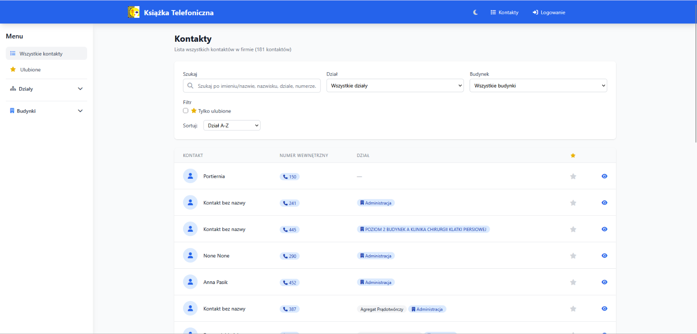
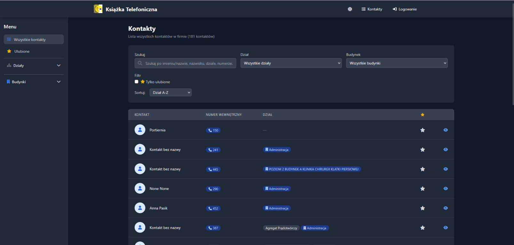

# Telephone Directory

A lightweight internal telephone directory for managing company contacts and
their extensions. The application provides a searchable contact list, filters
by department, favourites, contact details, administrator authentication, and
light/dark themes.

## Screenshots

### Light theme



### Dark theme



## Features

- Browse contacts with pagination.
- Search by name, surname, extension, department, company, or notes.
- Filter contacts by department and show favourites only.
- Sort contacts by department, surname, creation date, or favourites.
- Mark contacts as favourites for the current session or authenticated user.
- View, create, edit, and delete contacts.
- Export contact data to Excel and PDF.
- Administrator login protected with password hashing.
- Responsive interface with light and dark themes.
- JSON endpoints for contacts and favourites.
- SQLite persistence using SQLModel.

## Technology stack

- Python 3.11+
- FastAPI
- SQLModel and SQLite
- Jinja2 templates
- HTMX
- Tailwind CSS
- Font Awesome
- Docker Compose

## Project structure

```text
app/
|-- main.py                 # FastAPI application entry point
|-- auth.py                 # Authentication helpers
|-- config.py               # Environment-based configuration
|-- database.py             # SQLModel engine and sessions
|-- models/                 # Database and request/response models
|-- routers/                # HTML and API routes
`-- templates/              # Jinja2 views
static/                     # CSS and application assets
docs/screenshots/           # Application screenshots
```

## Running with Docker Compose

1. Copy the example environment file:

   ```powershell
   Copy-Item .env.example .env
   ```

2. Set a unique administrator password and secret key in `.env`.
3. Start the application:

   ```powershell
   docker compose up --build
   ```

4. Open [http://localhost](http://localhost) in a browser.

The application listens on port `80` by default. Change the port mapping in
`docker-compose.yml` if port 80 is already in use.

## Running locally

Create a virtual environment, install the dependencies, and start Uvicorn:

```powershell
python -m venv .venv
.\.venv\Scripts\Activate.ps1
pip install -r requirements.txt
uvicorn app.main:app --host 127.0.0.1 --port 8000 --reload
```

Then open [http://127.0.0.1:8000](http://127.0.0.1:8000).

The interactive API documentation is available at:

- [Swagger UI](http://127.0.0.1:8000/docs)
- [ReDoc](http://127.0.0.1:8000/redoc)

## Configuration

Configuration is read from environment variables or a local `.env` file:

| Variable | Description | Example |
| --- | --- | --- |
| `ADMIN_EMAIL` | Initial administrator email | `admin@example.com` |
| `ADMIN_PASSWORD` | Initial administrator password | `change-me` |
| `SECRET_KEY` | Session signing key | A long random value |
| `DATABASE_URL` | SQLAlchemy database URL | `sqlite:///./ksiazka_tele.db` |
| `DEBUG` | Enable development reload/debug behavior | `False` |

The initial administrator account is created on application startup when it
does not already exist. Change the example credentials before deploying the
application. Never commit `.env` or real credentials to source control.

## API overview

The application exposes JSON endpoints for:

- Listing and managing contacts under `/api/kontakty`.
- Listing the current user's favourites under `/api/favorites`.
- Checking or toggling a contact's favourite status.

For the complete request and response schemas, open `/docs` while the
application is running.

## License

No license has been specified yet. Add a license before distributing the
project publicly.
